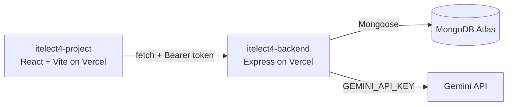

# itelect4-project-it4b

[](https://github.com/yuki-dev14/itelect4-project-it4b/actions/workflows/ci.yml)

The frontend for the ITELECT4 class project: a campus lost and found tracking platform built with React, Vite, Tailwind CSS, TypeScript, and TanStack Query, connecting to an Express backend and Google Gemini AI for project reviews.

- **Live Application:** https://itelect4-project-it4b.vercel.app
- **Live API Health:** https://itelect4-backend-euclids-projects-447a0a30.vercel.app/api/health
- **Backend Repo:** https://github.com/yuki-dev14/itelect4-backend

## Architecture



## Features

- **Item Tracking:** Browse, view, and report lost and found items across campus.
- **Claim Processing:** Submit and view verification claims for items.
- **Authentication:** Student login and registration with JWT authentication.
- **AI Project Review:** Request automated project reviews powered by Google Gemini.
- **Automated Testing & CI:** Vitest and React Testing Library suites verified on every push via GitHub Actions.

## Running Locally

1. Install dependencies:
   ```bash
   npm install
   ```
2. Configure `.env` based on `.env.example`:
   ```bash
   VITE_API_URL=http://localhost:4000/api
   ```
3. Run the development server:
   ```bash
   npm run dev
   ```
4. Run tests:
   ```bash
   npm test
   ```
5. Run linting:
   ```bash
   npm run lint
   ```
6. Build for production:
   ```bash
   npm run build
   ```

## AI Disclosure

This project integrates Google's Gemini API for generating intelligent student project reviews. AI coding assistants were used to assist in testing scaffolding, component validation, CI workflow configurations, and documentation adhering to course specifications.
